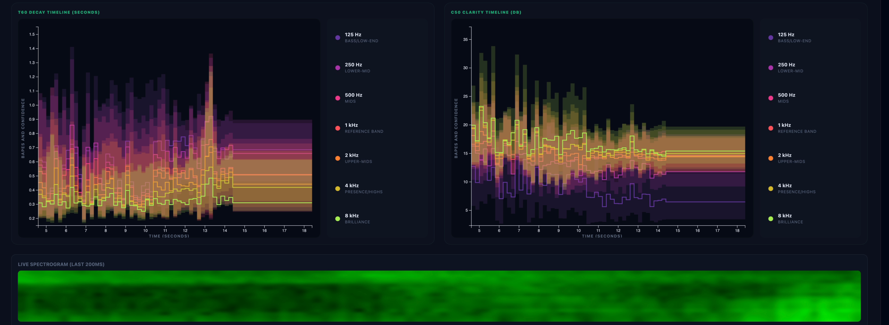
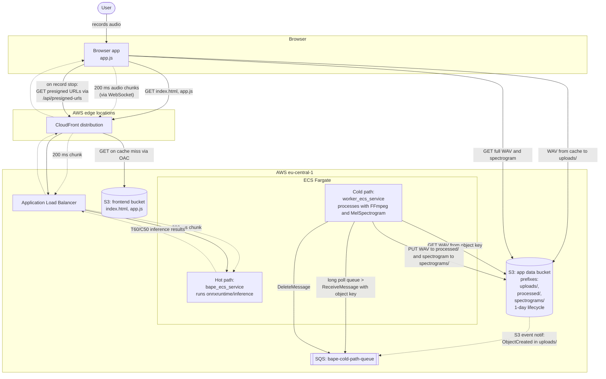

# Deploying BAPE (Blind Acoustic Parameter Estimator), a spatial-acoustic ML PyTorch model from local prototype to a real-time cloud service

*An end-to-end AWS deployment portfolio: taking a research PyTorch model and evolving its infrastructure through **seven iterative stages** — from a local ONNX script to a distributed, real-time inference service on ECS Fargate with an async, queue-driven processing path.*

<p align="center">
  
</p>

**[▶️ 30-second demo](phase-7/docs/demo.gif)** — live T60 estimation across 7 octave bands from microphone audio.

*Live demo offline to keep infra costs at zero — the stack stands up from Terraform on demand (see [Status & roadmap](#status--roadmap)).*

## The model

The BAPE model is research by Philipp Götz, Cagdas Tuna, Andreas Brendel, Andreas Walther and Emanuël A. P. Habets (International Audio Laboratories Erlangen - Fraunhofer IIS):

> Götz, P., Tuna, C., Brendel, A., Walther, A., & Habets, E. A. P. (2026).
> *Multi-stage representation learning for blind room-acoustic parameter estimation with
> uncertainty quantification.* The Journal of the Acoustical Society of America, 159(1), 247–259.
> [doi:10.1121/10.0042193](https://doi.org/10.1121/10.0042193)

The model, its training code and its weights are **not my work**, but are used and published here with the permission of the author. 
This repository deploys the research results to inference services in different architectural forms, adding the cloud infra architecture, Infrastructure-as-Code, container orchestration, security, cost control and CI/CD around it.

If you build on this, please cite the paper above (see [`CITATION.cff`]()).

## Why this project

After getting my AWS SAA C03 certification, I am looking for **Cloud / Platform / DevOps Engineering** roles and opportunities to apply my skills.
At this point in time I was given the great opportunity to deploy cutting-edge research and thereby make it available to the research community but also prepare for next steps, like using the resulting params to generate new speech outputs mimicking the spatial profile (T60 and C50) of the input signal.

I used this project to apply what I learned for my certification to a real-world project. That's also why I started as small as possible, layered abstraction incrementally and iterated in seven stages, each stage solving the shortcomings of the last. The result is a documented decision trail showing *how* and *why* my architecture developed.

Each `phase-N-*/` directory is a self-contained snapshot of the architecture at the end of that stage, including dependencies and documentation. The latter is work in progress.

## What it does (current Phase 7 deployment)

You speak into your browser microphone. 

The main app…
1. streams your audio to the `bape_ecs_service` container (running on ECS Fargate) which
2. normalizes the data and generates the input spectrogram
3. runs real-time inference using `onnxruntime`
4. returns (both across 7 frequency bands)
   - T60 (reverberation time) and 
   - C50 (clarity index)  
5. The frontend receives the estimates and renders them as live charts and a rolling spectrogram. 

When you stop,… 
1. the full recording is cached client-side (and encoded to 16-bit PCM WAV)
2. the client sends a `GET` request to `api/presigned-urls`
3. the API creates S3 presigned URLs for
   - `upload_url`, where the cached recording is uploaded to
   - `wav_download_url`, where the normalized wav will be available
   - `spec_download_url`, where the full spectrogram will be available
4. client `PUT`s the file to the app data bucket (`uploads/` prefix) when the upload URL is available
5. the upload triggers an S3 event notification (`ObjectCreated`) which has the objecvt key is sent to the `bape-cold-path-queue` SQS queue
6. a second `worker_ecs_service` container (running on ECS Fargate) polls the SQS queue
7. the worker 
   - uses `FFmpeg` to resample the input WAV (16 kHz, mono)
   - calculates the complete spectrogram 
   - uploads the files to S3 (to `processed/` and `spectrograms/`) using its IAM role
   - deletes the message from the queue
8. The frontend polls the presigned URLs and displays WAV file and spectrogram once they are available.

---

## Current architecture (Phase 7)

The production stage splits inference into a latency-sensitive **hot path** and a decoupled, CPU-heavy **cold path**, so real-time WebSocket sessions are never starved by full-recording processing.



---

## Run it

```bash
git clone https://github.com/dielaenge/onnx-deployment.git
cd onnx-deployment/phase-7
uv sync                      # creates .venv from uv.lock
uv run python -m app.main    # http://127.0.0.1:8000
```

Requires [uv](https://docs.astral.sh/uv/).

The cloud-based features (cold-path worker, presigned URLs) need AWS credentials and resource names. 
Copy [`phase-7/.envrc.example`](phase-7/.envrc.example) to `.envrc` and fill it in. To stand up the full stack, apply `phase-7/terraform/persistent` first, then `phase-7/terraform/compute`; details in the [phase 7 README](phase-7/README.md).

---

## What are the 7 phases?

The project evolved over separated stages to its latest design.

| # | Stage | Problem it solves | Key (AWS) skills | Status |
|---|---|---|---|---|
| **1** | Local ONNX deployment | make a dummy model available locally for inference, either via CLI or FastAPI wrapper | ONNX Runtime, FastAPI, packaging | early learning step - not maintained; dummy model outputs have no meaning |
| **2** | Naive cloud deployment | make the dummy model available in the cloud | EC2, security groups, SSH, FFmpeg/librosa | early learning step - not maintained; dummy model outputs have no meaning |
| **3** | Production-ready networking | make the model available at scale and securely; also export the real BAPE PyTorch model to ONNX | VPC design, ALB, NATGW, HA across AZs, MLOps | frozen snapshot, outputs not validated |
| **4** | Serverless Function | Make the model available in the cloud as a FaaS with minimal maintenance overhead and zero idle costs | Lambda container image, ECR, CloudFront/S3 split, presigned URLs | frozen snapshot, outputs not validated |
| **5** | Serverless container orchestration | Make the model instantaneously available (no cold starts) as a containerized application, reducing environment maintenance | ECS Fargate + Terraform, remote state, OIDC CI/CD GitHub Actions | frozen snapshot, outputs not validated |
| **6** | Real-Time production | Make model available for real-time inference | **WebSockets** on ALB/CloudFront, Web Audio API, right-sizing | frozen snapshot; runs, decision log pending, outputs not validated |
| **7** | Distributed hot/cold path orchestration | separate workload of real-time inference and post-processing for entire recording session, separating containers to improve performance  | SQS-driven async worker, second Fargate service, S3 events | active; model export uses a numerical-parity check against reference outputs from research before writing new exports |

Model versions across phases: 
- Phases 1–2 run a dummy model
- Phases 3–6 each carry a dedicated ONNX export to estimate T60 params
- Phase 7 runs two separate ONNX models for T60 and C50; exporter script able to export both, which wasn't the case before

---

## Which capabilities were applied? Where?

Each row points to the phase where the capability is actually built, so you can jump straight to the code and its decision log.

| Capability | How it shows up here | Go to |
|---|---|---|
| **VPC networking** | 2 public / 2 private subnets across 2 AZs, IGW, NAT GW, then a NAT-free redesign using VPC endpoints | Phase 3, 5, 6, 7 |
| **Compute options** | Same workload on EC2, then Lambda (container image), then ECS Fargate — a deliberate compute-model comparison | Phase 2, 4, 5, 6, 7 |
| **Edge & delivery** | CloudFront over a private S3 origin (OAC), with dedicated cache behaviors routing `/ws*` and `/api/*` to the ALB | Phase 4, 5, 6, 7 |
| **Async / messaging** | S3 `ObjectCreated` → SQS → a separate Fargate worker, decoupling batch work from real-time | Phase 7 |
| **Infrastructure as Code** | Terraform with remote S3 state + native locking; later split into `persistent` vs `compute` modules | Phase 5, 6, 7 |
| **IAM & security** | Resource-scoped least-privilege policies, GitHub OIDC federation (zero static keys), private subnets, OAC | Phase 3, 4, 5, 6, 7 |
| **CI/CD** | GitHub Actions → ECR → ECS force-deploy, OIDC-authenticated and branch-locked per phase | Phase 5, 6, 7 |
| **Cost & privacy engineering** | NAT-free VPC endpoints, `PriceClass_100` CDN, and a 24h S3 lifecycle expiry (see below) | Phase 3, 4, 5, 6, 7 |

### No database was a deliberate design choice: 

This project intentionally has **no data tier**. The workload processes user microphone audio and estimates the spatial characteristics of the record surroundings, so **privacy is a hard requirement**: recordings are expired within 24 hours by an S3 lifecycle policy and nothing is persisted beyond that window. 
Adding a database would have meant storing personal audio data I have no reason to keep. Choosing a **stateless, zero-retention architecture** is the more defensible engineering decision here, privacy-by-design over a checkbox.

---

## Repository layout

```
phase-1-local_deployment/        # ONNX runtime, CLI + FastAPI
phase-2-manual_cloud_deployment/ # click-ops EC2
phase-3-proper-infra/            # custom VPC, ALB, private subnets + BAPE→ONNX export
phase-4-serverless_deployment/   # Lambda container image
phase-5-container-orchestration/ # ECS Fargate + Terraform
phase-6-production-ready/        # WebSocket real-time inference
phase-7/                         # distributed hot-path + cold-path (current)
```
> **Cloning:** a plain `git clone` gets everything needed to run phase 7 locally, including the
> exported ONNX models. There are no submodules. Regenerating the models is a separate, optional
> path that needs the private BAPE research repository and unpublished weights — see
> [`phase-7/scripts/README.md`](phase-7/scripts/README.md).

Infrastructure for phases 5–7 is defined in each phase's `terraform/` directory; deployment is
automated via GitHub Actions (`.github/workflows/deploy-phase{5,6,7}.yml`).


---

## Highlighted engineering decisions

- **NAT-free private egress** — private subnets reach S3/ECR/CloudWatch/SQS via VPC endpoints
  instead of a NAT Gateway, removing a significant fixed monthly cost.
- **GitHub OIDC over static credentials** — CI/CD assumes a branch-locked IAM role via OIDC federation; no long-lived AWS keys stored in GitHub.
- **Presigned-URL claim-check pattern** — large audio bypasses the apps backen, uploading straight to S3 to keep the request path light.
- **Privacy-by-design** — a 24-hour S3 lifecycle expiry means user recordings are never retained.
- **Hot/cold decoupling via SQS** — CPU-spiky batch work runs on its own Fargate service so it can't degrade live WebSocket latency.

---

## Status & roadmap

Phase 7 is the most advanced architecture and is **deployable end-to-end via the included
Terraform + CI/CD**. To keep costs at zero between demos, the cloud stack is **not kept
permanently running** — it is stood up from IaC on demand. Phases 1–6 are preserved as
historical snapshots of the architecture at each stage.

This repo is under active polish. Current and next steps:

- **Per-phase architecture diagrams** (Mermaid, rendered inline) — in progress
- **Per-phase decision logs** distilled from the development record - in progress
- [ ] **A demo for each phase** — reproducible IaC where practical, annotated screenshots / a
      short screen recording at minimum
- [ ] A one-command teardown/standup note per phase for cost-safe reproduction
