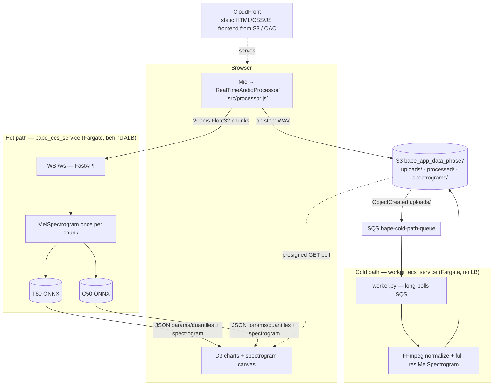

# Phase 7 — Distributed Hot-Path / Cold-Path Inference

> Real-time streaming inference decoupled from asynchronous post-processing initiated via queue.

Phase 7 splits the single real-time service from [Phase 6](../phase-6-production-ready) into two independently-scaled workloads on **ECS Fargate**:

- a **hot path** — *"get live results"*; latency-sensitive, real-time inference streamed over WebSockets, and
- a **cold path** — *"review the entire session"*; latency-insensitive, full-recording processing driven asynchronously through SQS.

The design goal: 
Establishing a real-time inference service was a valuable increment but, in the interest of research users, both live results and analysis of (past) recording sessions must be made available.
This is foundational to separating pipelines: post-processing a full recording must never introduce latency to or drop a live connection. 

Thus, live-inference and post-processing run on two separate paths as separate Fargate services from the same image. They communicate via S3 event notifications which occur when a recording ends, presigned URLS are generated and land in the SQS queue from where the worker process takes over.

## Architecture



## Hot path

Browser mic audio is 
- captured by `RealTimeAudioProcessor`, an extension of ([`AudioWorkletProcessor`](https://github.com/dielaenge/onnx-deployment/blob/106f0a5ab71e4ff428a1a68442eb474918217c61/phase-7/src/processor.js#L2)), 
- buffered into 200 ms / 3200-sample chunks, and 
- streamed as raw binary `Float32Array` over the WebSocket. 

The server ([`app/main.py`](app/main.py) `WS /ws`) 
- keeps a rolling **4 s (64000-sample) [`audio_buffer` and runs an inference loop](https://github.com/dielaenge/onnx-deployment/blob/106f0a5ab71e4ff428a1a68442eb474918217c61/phase-7/app/main.py#L123-L167)**, 
  - deletes the oldest 200ms/3200 sample-chunks and adds new, incoming chunks,
- processes a new 4 second spectrogram every 200ms (), and 
- [runs both ONNX models **concurrently**](https://github.com/dielaenge/onnx-deployment/blob/106f0a5ab71e4ff428a1a68442eb474918217c61/phase-7/app/main.py#L169-L176) 
- streams back response_json (params / quantiles / latents for both models, the newest spectrogram `spectrogram_latest100frames`, and `inference_time_ms`). Measured inference is ~30–60 ms per stride after warmup.

## Cold path

On mic stop, the browser encodes the full recording to WAV client-side, fetches presigned URLs from `GET /api/presigned-urls`, and `PUT`s the WAV directly to S3 (`uploads/` prefix) bypassing the compute infrastructure entirely. An S3 `ObjectCreated` notification (filtered to `uploads/`) enqueues to SQS. 
The worker ([`app/worker.py`](app/worker.py)) 
- long-polls the queue, 
- downloads the WAV, 
- normalizes it with FFmpeg, 
- regenerates a full-resolution spectrogram, 
- uploads results to `processed/` / `spectrograms/`, and only then 
- deletes the SQS message. 

The browser polls the presigned download URL (exponential backoff) until the results are ready.

## Key engineering decisions

- **Separate ONNX models for T60 and C50**, run concurrently; each estimator can be re-exported or re-weighted independently via [`conf/exporter.yaml`](https://github.com/dielaenge/onnx-deployment/blob/106f0a5ab71e4ff428a1a68442eb474918217c61/phase-7/conf/exporter.yaml).
- **Training / inference dependency split** — the phase 7 image ships `onnxruntime` + `fastapi` (~150 MB), while dependency groups required for the ONNX export are opt-in via the `uv` flag `--group onnx_export`; `uv sync` does not install the `onnx_export` packages and the Dockerfile does not require them.
- **Split Terraform state** — To speed up deployment without increasing costs the terraform code base was split into two separate layers:
  - [`terraform/persistent/`](terraform/persistent) (S3, ECR, SQS, IAM, CI/CD OIDC) and 
  - [`terraform/compute/`](terraform/compute) (VPC, ECS, ALB, CloudFront)
  
`/compute`, the cost-driving layer, can be destroyed and re-applied without touching `/persistent` state.
- **No NAT Gateway** — private subnets reach AWS services through VPC interface/gateway endpoints (S3, ECR, CloudWatch Logs, SQS), which avoid NAT Gateway costs but introduces endpoint costs.
- **Privacy by design** — voice recordings and their spatial information are sensitive data, which the project does not want to manage. Therefor all data written to S3 has a 1-day lifecycle expiry and is only ever processed in RAM writing nothing to storage; this is a deliberate decision for minimum data retention.
- **Numerical-parity CI testing** — the [ONNX exporter self-tests](https://github.com/dielaenge/onnx-deployment/blob/106f0a5ab71e4ff428a1a68442eb474918217c61/phase-7/scripts/param_estimator-onnx_exporter.py#L146-L182) against [reference PyTorch outputs (`cfg_output_tuple`)](https://github.com/dielaenge/onnx-deployment/blob/106f0a5ab71e4ff428a1a68442eb474918217c61/phase-7/scripts/param_estimator-onnx_exporter.py#L126-L135) before export.


## Known open issue — hot/cold drift

The two paths compute the same mel spectrogram through two different implementations: 
The real-time hot path has to work incrementally on a live stream and computes computing one spectrogram every 200 ms.
The cold path starts on a full recording, has no special latency requirements, can normalize it with FFmpeg and process it in full-resolution slices. 
Batch post-record and live-stream processing therefor require different approaches. 

Both paths apply the same 4-second sliding local standardization, which was lacking before commit `764e2d4`.
This surfaced when comparing the pipelines because of the beforementioned implementation differences. 
After aligning the standardization in both processes, a Mean Squared Error (MSE) of ~1.5 could be brought down to **0.018**. 
Remaining untested candidates: chunked vs. whole-signal STFT boundaries, and FFmpeg's amplitude normalization.

How much more the two implementations could be aligned is an open question and running the chunked algorithm over the full file on the cold path is planned for a future increment.

Enabling (`1`, `true`, `yes`) the `DEBUG_SPEC_DUMP` env variable will write numpy dumps to `app/models/npy-dumps/` when the hot or cold path run:

```bash
# hot-path
DEBUG_SPEC_DUMP=1 uv run python -m app.main # writes `models/npy-dumps/spec_cold_<session_id>.npy`

# cold-path
DEBUG_SPEC_DUMP=1 uv run python -m app.worker # writes `models/npy-dumps/spec_hot_<session_id>.npy`).
```
Related sessions will share session UUIDs.

You can then compare hot vs cold path results:
```bash
uv run python scripts/compare_pipelines.py <fill-in-session-uuid>
```

Or run the test with provided examples: 
```bash
uv run python scripts/compare_pipelines.py example
```
---

## Run locally

***Requirements:*** 
* [uv](https://docs.astral.sh/uv/) for virtual environment and installing dependencies.
* [`direnv`](https://direnv.net) to automatically load environment variables (SQS queue URL, presigned URLs, app data bucket) via `.envrc`.

1. **Create .venv and launch the main process**
```bash
cd phase-7
uv sync                     # no onnx_export dependencies, see pyproject.toml
uv run python -m app.main   
```
The run command resolves `UVICORN_HOST/UVICORN_PORT` env variables from the [ECS task](https://github.com/dielaenge/onnx-deployment/blob/106f0a5ab71e4ff428a1a68442eb474918217c61/phase-7/terraform/compute/ecs.tf#L43-L50), or, if run locally, defaults them to `127.0.0.1:8000`

Running locally, the frontend is served from the cloned `src/` directory, while the models are loaded from [`app/models`](app/models/).
In production, running in the cloud, CloudFront serves the frontend from S3, while the onnx model is baked into the image (which is subject to change).

2. **Connect cold-path pipeline**
The cold-path worker runs as a separate process on ECS and ***requires*** AWS credentials, the SQS queue and S3 app data bucket (which Terraform will provide after applying, see code below).

To use your AWS credentials: 

- fill your credentials in [`.envrc.example`](.envrc.example)
- save it to `phase-7/.envrc` and 
- ***!!add `.envrc` to .gitignore!!*** 
- fill in 


3. Start the cold-path worker.
```bash
uv run python -m app.worker
```
### Running the deployed artifact instead

The command above runs the app as a local process, which is best to iterate on. It also serves the frontend. 

To run exactly what runs on ECS Fargate:

```bash
docker build -t bape-local .
docker run --rm -p 8080:8080 bape-local
curl localhost:8080/health
```

The container has no frontend. 
In production it is served via a CloudFront distribiution (CDN) which sources it from S3. 
Running the image will give you the API and `/health`.

### Exporting the ONNX model
The model export pipeline is **not** part of `uv sync`, but can also be reproduced, see [`scripts/README.md`](scripts/README.md).

## Layout

```
phase-7/
├── app/            FastAPI hot path (main.py), cold-path worker (worker.py), inference_engine.py
├── src/            Frontend — index.html, app.js, processor.js (AudioWorklet)
├── scripts/        ONNX exporter, compare_pipelines.py — see scripts/README.md
├── conf/           Hydra config for the exporter
├── terraform/      persistent/ + compute/ (two independent root modules)
├── Dockerfile      Single image; hot and cold services differ only by task command
└── pyproject.toml  Dependencies and dependency groups; uv.lock pins exact versions
```